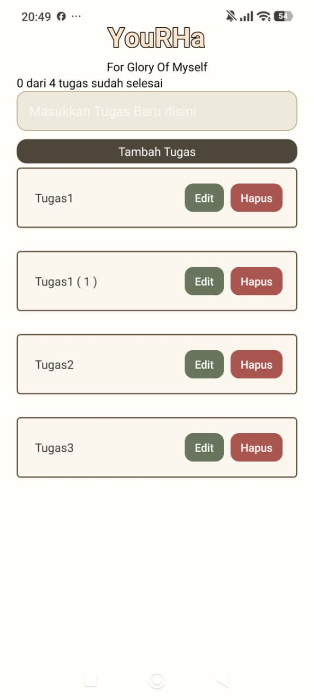

  
  <h1>YouRHa</h1>
  
<strong>Glory to Myself</strong>

  
A personal task manager designed to help you stay organized with fewer distractions.

  
<a href="https://github.com/USERNAME/REPOSITORY/releases/latest/download/YouRHa.apk"><strong>Download YouRHa for Android</strong></a>

---

## About YouRHa

YouRHa is a personal mobile application built to make everyday task management feel clear and manageable. Its purpose is to help you focus on what matters, keep track of small responsibilities, and reduce unnecessary distractions. The interface is designed around a straightforward task list and a calm visual presentation, without social feeds, multiple user accounts, or unnecessary layers of interaction.

Your tasks are stored locally on your device using SQLite. You do not need to create an account to use the current task manager. Because the data is stored locally, clearing the app's storage or uninstalling the app may remove saved tasks. Cloud synchronization and online backup are not currently available.

## App Preview

  

## Features

YouRHa currently provides the core features needed to manage personal tasks in one place. You can create a task, view your saved task list, edit an existing task, mark a task as complete or incomplete, and remove tasks you no longer need. A progress indicator shows how many tasks have been completed. Empty task titles are validated, and duplicate titles are distinguished with an automatically assigned number so similarly named tasks can remain in the list.

Task data is persisted locally with SQLite, allowing saved tasks and their completion states to remain available when you close and reopen the app. These behaviors should be verified on the build you install, as storage can be removed by clearing app data or uninstalling the app.

A Music experience is being explored to support focus sessions and everyday routines. The intended direction is to let users search YouTube videos and play eligible videos inside YouRHa through YouTube's official embedded player. The search service is currently being prepared, but the complete Music interface and playback flow are not yet confirmed as working in the app. Music should therefore be considered in development, not an available feature of the current release.

## Technology Stack

| Technology | Purpose | Status |
|---|---|---|
| React Native | Builds the mobile user interface for Android. | In use |
| Expo | Provides the development workflow and app tooling. | In use |
| JavaScript | Implements application behavior and UI logic. | In use |
| `expo-sqlite` | Stores task data locally on the device. | In use |
| YouTube Data API v3 | Searches for videos and returns video metadata for the planned Music feature. | Integration in progress |
| Official YouTube embedded player | Plays videos that are available for embedding. | Planned; Android playback still needs verification |

## Download and Install on Android

To install YouRHa on an Android phone, tap **Download YouRHa for Android** at the top of this page. Once an APK has been uploaded to the project's GitHub Releases page, the link will download `YouRHa.apk` directly to the device. Open the downloaded file and follow Android's installation prompts. Android may ask you to allow installation from the browser or file manager; only continue if you trust the source of the APK.

The download link currently uses this GitHub Releases address: `https://github.com/USERNAME/REPOSITORY/releases/latest/download/YouRHa.apk`. Before publishing this README, replace `USERNAME/REPOSITORY` with the correct GitHub account and repository name. Then create a GitHub Release and upload the Android APK as an asset named exactly `YouRHa.apk`. The link will not work until that release asset exists. Do not link to a file path on your personal computer, because other people cannot access files stored on your device.

If you build the release APK locally, the file is typically generated at `android/app/build/outputs/apk/release/app-release.apk` when a release build succeeds. Copy that file, rename the copy to `YouRHa.apk`, and upload it to the GitHub Release. Test the release download link on a phone before sharing the README.

## Project Status

The task manager is the current usable part of YouRHa. The Music feature is still being developed and should not be described as available until search results and embedded playback have been tested on Android. The app is a personal productivity tool rather than a social platform; its central goal is to support a more organized routine while keeping the experience focused and low-distraction.

---

  
<strong>YouRHa, Glory to Myself.</strong>

  
Stay organized. Keep your attention on what matters.

