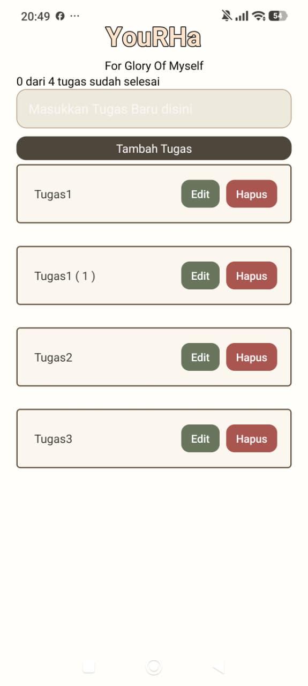

<div align="center">
  
  <h1>YouRHa</h1>
  <p><strong>Glory to Myself</strong></p>
  <p>A personal task manager designed to help you stay organized with fewer distractions.</p>
</div>

---

## About YouRHa

YouRHa is a personal mobile application built to make everyday task management feel clear and manageable. Its purpose is to help you focus on what matters, keep track of small responsibilities, and reduce unnecessary distractions. The interface is designed around a straightforward task list and a calm visual presentation, without social feeds, multiple user accounts, or unnecessary layers of interaction.

## App Preview

<p align="center">
  
</p>

## Features

- Create, view, edit, and delete tasks.
- Mark a task as completed or not completed.
- See progress at a glance ("2 dari 5 tugas sudah selesai").
- Empty or whitespace-only titles are rejected.
- Duplicate titles are numbered automatically, ignoring letter case: adding "belajar" when "Belajar" exists saves "belajar ( 1 )". Editing a task does not count its own title as a duplicate.
- Loading, empty-list, and error messages for database operations.
- Tasks are stored locally on the device with SQLite. No account is needed, and there is no cloud sync, so clearing the app's storage or uninstalling the app removes saved tasks.

A Music feature for focus sessions (YouTube search with the official embedded player) is planned and is not part of the app yet.

## Tech Stack

| Technology | Purpose |
| --- | --- |
| React Native + Expo (SDK 58) | Mobile UI and development tooling |
| JavaScript | Application logic |
| `expo-sqlite` | Local task storage |
| `react-native-svg` | Outlined app title |
| Jest + `jest-expo` | Unit tests |
| ESLint (`eslint-config-expo`) | Linting |

## Project Structure

```
App.js                  Main screen: state, CRUD handlers, and layout
components/
  TaskForm.jsx          Title input with add/save and cancel buttons
  TaskItem.jsx          One task row with toggle, edit, and delete
database/
  tasks.js              SQLite queries (create table, insert, select, update, delete)
utils/
  taskTitle.js          Title validation and duplicate numbering (pure function)
  __tests__/            Unit tests
```

## Getting Started

Requirements: Node.js (LTS) and npm, plus an Android phone or emulator. Building the Android app locally also needs Android Studio with the Android SDK.

```bash
git clone https://github.com/Raakuha/YouRHa.git
cd YouRHa
npm install
```

Build and run the app on a connected Android device or emulator:

```bash
npm run android
```

After the app is installed, you can start only the development server with:

```bash
npm start
```

## Running Tests

```bash
npm test
```

Tests live in `utils/__tests__/` and cover the title validation in `utils/taskTitle.js`. To check code style, run `npm run lint`.

## Project Status

The task manager is the current usable part of YouRHa. An Android APK has not been published yet; to try the app, build it from source as described above. The Music feature is still in planning.

---

<div align="center">
  <p><strong>YouRHa, Glory to Myself.</strong></p>
  <p>Stay organized. Keep your attention on what matters.</p>
</div>
